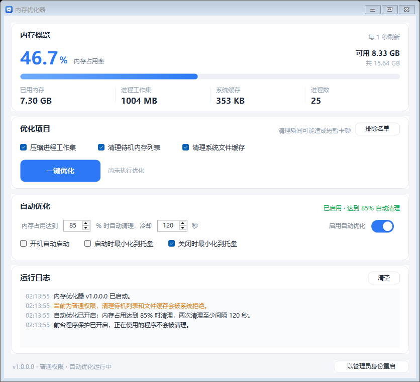

# 内存优化器 (MemoryOptimizer)

一个 Windows 小工具：一键或按阈值自动清理**进程工作集**、**待机内存列表**和**系统文件缓存**，并常驻托盘。



## 功能

- **实时内存概览**：占用率、已用/可用/总量、进程工作集合计、系统缓存、进程数，每秒刷新，进度条平滑动画。
- **一键优化**（`F5`）：
  1. 刷新系统文件缓存（`SetSystemFileCacheSize`）
  2. 压缩所有可访问进程的工作集（`EmptyWorkingSet`）
  3. 清空待机内存列表 Standby List（`NtSetSystemInformation`）
- **自动优化**：内存占用达到阈值（默认 **85%**）时自动执行，两次之间至少间隔 **120 秒**（冷却时间可调），默认开启。
- **排除名单 / 前台保护**：可以指定不参与清理的进程；默认跳过「当前前台窗口所属的进程」，正在玩的游戏、正在用的软件不会被清理。
- **托盘常驻**：关闭窗口默认最小化到托盘，自动优化继续工作；托盘菜单可打开主界面、立即优化、开关自动优化、退出。
- **开机自启 / 启动时最小化 / 关闭时最小化**，全部可在界面里勾选。
- **权限提示与一键提权**：底部显示当前权限；非管理员时可点「以管理员身份重启」。
- **日志**：界面内彩色日志，同时写入程序目录 `MemoryOptimizer.log`（超过 512 KB 自动轮换）。
- **快捷键**：`F5` 立即优化。
- 单实例运行，重复启动会提示已在运行。

## 使用方法

1. 双击 **`内存优化器.lnk`** 或 **`Launch.bat`** 启动（推荐，见下方「SmartScreen 提示」）；也可以直接双击 `MemoryOptimizer.exe`。
2. 想要管理员权限（清理待机列表 / 文件缓存、处理其他用户的进程）：
   - 运行一次 `SetupElevatedTask.bat`（会弹一次 UAC，注册一个按需运行的计划任务）；
   - 以后双击 `LaunchElevated.bat` 即以管理员身份启动，不再弹 UAC / SmartScreen；
   - 或者右键 exe「以管理员身份运行」（每次都会弹 UAC）。

| 清理项 | 普通权限 | 管理员权限 |
| --- | --- | --- |
| 压缩进程工作集 | 只能清理当前用户的进程 | 可清理几乎全部进程 |
| 清空待机内存列表 | 被拒绝（`STATUS_PRIVILEGE_NOT_HELD`） | 成功 |
| 刷新系统文件缓存 | 被拒绝（错误码 5） | 成功 |

3. 首次启动会读取默认配置：自动优化开启、阈值 85%、冷却 120 秒。可在「自动优化」卡片里修改。
4. 想保护某个程序时，点「优化项目」右上角的 **「排除名单」**，每行填一个进程名（可不带 `.exe`）；「清理时跳过前台程序」默认勾选。
5. 关闭窗口会缩到托盘。要彻底退出，请用托盘右键菜单的「退出」。

### SmartScreen 提示

程序没有代码签名证书，直接双击 `MemoryOptimizer.exe` 时 Windows 可能弹出「Microsoft Defender SmartScreen 阻止了无法识别的应用启动」。这是「未签名 + 无信誉」的提示，不是杀毒报毒。

- 点「更多信息 → 仍要运行」可以临时放行，但重新编译后文件变了还会再弹。
- **推荐**：用 `Launch.bat` / `内存优化器.lnk` 启动。它们通过 CreateProcess 启动 exe，不经过资源管理器的 SmartScreen 检查（缺点：不带管理员权限）。
- 需要管理员又不想看提示：运行一次 `SetupElevatedTask.bat`，之后用 `LaunchElevated.bat`（计划任务以最高权限运行，不经过 shell）。
- 也可以关闭 SmartScreen 的「检查应用和文件」（Windows 安全中心 → 应用和浏览器控制 → 基于声誉的保护 → 设置），但这是系统级关闭，会降低整体防护。
- 彻底解决需要给 exe 购买正规代码签名证书（EV 证书可立即建立信誉）；自签名证书对 SmartScreen 无效。
- 兼容性设置里的「以管理员身份运行此程序」并不能绕过 SmartScreen，只会再多弹一个 UAC。

### 让 exe 双击直接运行（不再弹 SmartScreen）

Windows 没有「单个文件的 SmartScreen 白名单」，要让 `MemoryOptimizer.exe` 本身双击即开，只能二选一：

1. **关掉系统的「检查应用和文件」**（可逆，一键脚本）
   - 双击 `DisableSmartScreenCheck.bat`：会弹一次 UAC，写入组策略并可选重启资源管理器；
   - 之后双击 `MemoryOptimizer.exe` 即可直接运行，不再拦截；
   - 双击 `RestoreSmartScreenCheck.bat` 可恢复默认；
   - 等价的图形界面操作：Windows 安全中心 → 应用和浏览器控制 → 基于声誉的保护 → 设置 → 关闭「检查应用和文件」；
   - 副作用：所有未签名/未识别程序都不再被拦，属于系统级降低防护；设置生效后该开关在安全中心里可能显示「由管理员管理」。
2. **给 exe 代码签名**：需要正规 CA 的代码签名证书（EV 证书可立即建立 SmartScreen 信誉）；自签名证书无效。

> 注意：属性对话框里的「解除锁定」只出现在**文件**（exe）的属性里，文件夹属性没有这一项；而且本目录构建出的 exe 本身不带网络来源标记（无 `Zone.Identifier`），所以这一步不适用。

## 配置文件

优先保存在 **exe 同目录** 的 `settings.ini`（便携）；若该目录不可写（例如放在 `Program Files`），自动回退到 `%APPDATA%\MemoryOptimizer\settings.ini`。

```ini
TrimWorkingSets=1     # 压缩进程工作集
PurgeStandby=1        # 清空待机内存列表
ClearFileCache=1      # 刷新系统文件缓存
ExcludedProcesses=    # 额外排除的进程名，用 | 分隔，例如 chrome|obs64
ProtectForeground=1   # 跳过当前前台窗口所属进程
AutoEnabled=1         # 自动优化开关
ThresholdPercent=85   # 触发阈值（%）
CooldownSeconds=120   # 两次优化最小间隔（秒）
StartWithWindows=0    # 开机自启
StartMinimized=0      # 启动时最小化到托盘
CloseToTray=1         # 关闭窗口时最小化到托盘
```

开机自启写在注册表 `HKCU\Software\Microsoft\Windows\CurrentVersion\Run` 的 `MemoryOptimizer` 值，取消勾选会删除该值。

## 命令行参数

| 参数 | 说明 |
| --- | --- |
| `--minimized` | 启动后只驻留托盘，不显示主窗口（开机自启用它） |
| `--cli` | 不显示界面，执行一次优化并输出报告 |
| `--cli --out <文件>` | 指定报告路径，默认 `cli-result.txt` |
| `--shot <png>` | 把界面渲染成图片后退出（开发/预览用） |
| `--shot <png> --optimize` | 先执行一次优化再截图 |
| `--elevated` | 内部使用，标记以管理员身份重启 |

示例：

```bat
MemoryOptimizer.exe --cli --out D:\report.txt
```

## 实现原理

- **进程工作集**：`OpenProcess(PROCESS_QUERY_INFORMATION | PROCESS_SET_QUOTA)` + `EmptyWorkingSet()`（psapi）。跳过 `System`、`Registry`、`MemCompression`、`csrss`、`lsass`、`dwm` 等系统关键/受保护进程，以及排除名单、当前前台程序和自身；**只回收内存页，不会结束任何进程**。
- **待机内存列表**：`NtSetSystemInformation(SystemMemoryListInformation = 0x50, MemoryPurgeStandbyList = 4)`，需要 `SeProfileSingleProcessPrivilege` 特权（仅管理员令牌可用）。
- **系统文件缓存**：`SetSystemFileCacheSize(-1, -1, 0)`，需要 `SeIncreaseQuotaPrivilege` 特权。
- 程序启动时调用 `SetProcessDPIAware()`，界面按系统 DPI 缩放；全部控件自绘，不依赖第三方库。

「本次释放」是估算值：**进程工作集减少量 + 系统缓存减少量**（都只统计正值），实际效果受系统当前负载影响，仅供参考。

## 编译

只需要系统自带的 .NET Framework 4.x（Windows 10/11 默认安装），不需要 Visual Studio 或 .NET SDK：

```bat
powershell -NoProfile -ExecutionPolicy Bypass -File .\build.ps1
```

脚本会调用 `%WINDIR%\Microsoft.NET\Framework64\v4.0.30319\csc.exe` 把 `src\*.cs` 编译成 `MemoryOptimizer.exe`。

图标 `app.ico` 已生成；如需重新生成（可选）：

```bat
%WINDIR%\Microsoft.NET\Framework64\v4.0.30319\csc.exe /target:exe /r:System.Drawing.dll /out:tools\IconBuilder.exe tools\IconBuilder.cs
tools\IconBuilder.exe .
```

## 文件结构

```
MemoryOptimizer/
├─ MemoryOptimizer.exe      # 主程序（可直接分发）
├─ 内存优化器.lnk           # 推荐入口：指向 Launch.bat，带程序图标
├─ Launch.bat               # 普通权限启动，绕过 SmartScreen
├─ LaunchElevated.bat       # 通过计划任务以管理员启动，无 UAC/SmartScreen 提示
├─ SetupElevatedTask.bat    # 一次性注册「管理员权限」计划任务（需 UAC）
├─ DisableSmartScreenCheck.bat   # 一键关闭 SmartScreen 的「检查应用和文件」（需 UAC）
├─ RestoreSmartScreenCheck.bat   # 恢复 SmartScreen 默认设置（需 UAC）
├─ RunAsAdmin.bat           # 旧式提权（每次弹 UAC）
├─ README.md
├─ build.ps1                # 编译脚本
├─ app.ico                  # 图标
├─ screenshot.png           # 界面截图
├─ src/
│  ├─ Program.cs            # 入口、单实例、CLI / 截图模式
│  ├─ MainForm.cs           # 主界面、托盘、自动优化逻辑
│  ├─ Optimizer.cs          # 清理流程与结果统计
│  ├─ Native.cs             # Win32/NT API 封装
│  ├─ MemorySnapshot.cs     # 内存快照
│  ├─ Settings.cs           # 配置读写、开机自启、排除名单
│  ├─ Theme.cs / Controls.cs / MemoryGauge.cs / LogView.cs   # 自绘界面组件
│  ├─ ExcludeForm.cs        # 排除名单对话框
│  └─ AssemblyInfo.cs
└─ tools/
   ├─ IconBuilder.cs        # 生成 app.ico
   ├─ IconBuilder.exe
   ├─ launch.ps1            # Launch.bat 调用（CreateProcess 启动）
   ├─ setup-task.ps1        # SetupElevatedTask.bat 调用（注册计划任务）
   └─ sign.ps1              # 代码签名脚本（PFX 或证书指纹）
```

## 注意事项

- 压缩工作集会让进程之后重新从页面文件/磁盘读取内存页，**可能造成短暂卡顿**，建议在空闲时执行；不要设置过低阈值或过短冷却。
- Windows 自身的内存管理已经比较积极，正常使用时不必频繁清理，本项目更适合"玩游戏/跑大型软件前腾一点内存"的场景。
- 程序**不会结束任何进程**，只调用系统 API 回收内存页；程序本身也不会创建服务或计划任务（`SetupElevatedTask.bat` 是你手动运行的一次性辅助脚本，可以随时用 `schtasks /delete /tn MemoryOptimizer-Elevated /f` 删除）。
- 万一某个程序清理后明显变慢（例如大型游戏、虚拟机），把它加进「排除名单」即可，不需要重启程序。
- 杀毒软件可能对"批量操作进程内存"的行为敏感，如被拦截请添加信任。
- 非管理员运行时，界面会明确提示哪些项目被系统拒绝，不会静默失败。

## 许可证

MIT，见 [LICENSE](LICENSE)。如需换成 Apache-2.0 / GPL 等，替换 LICENSE 文件并在 README 中注明即可。
